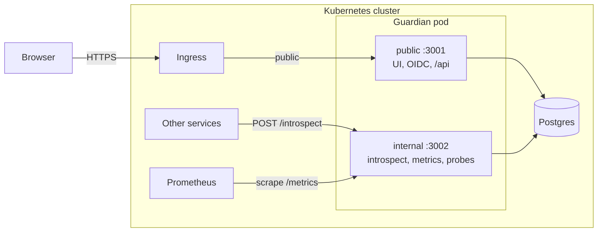
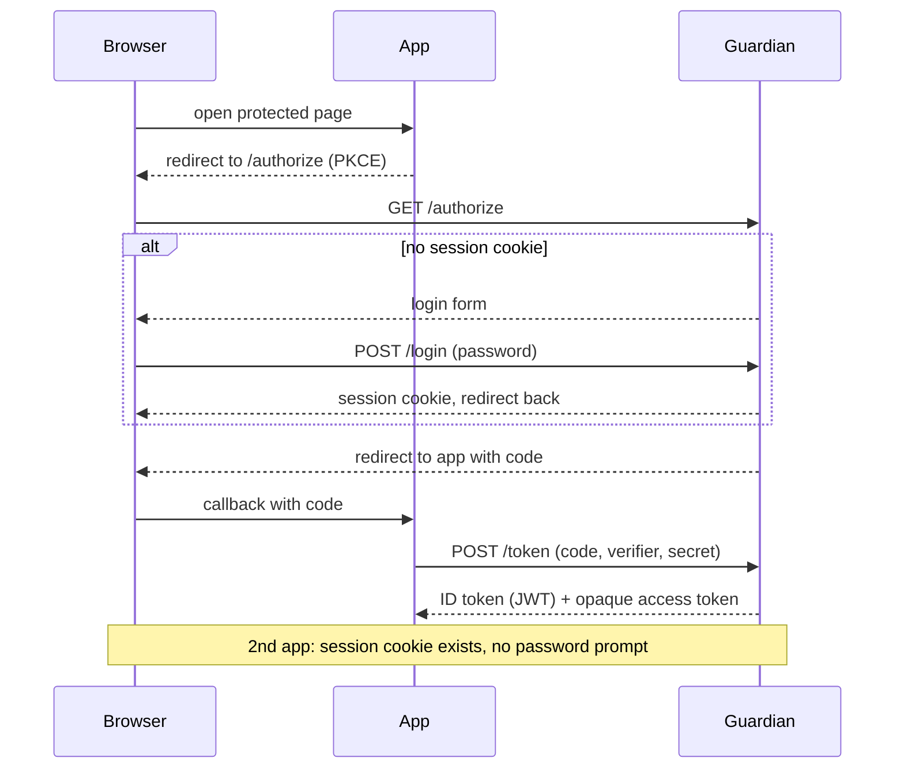
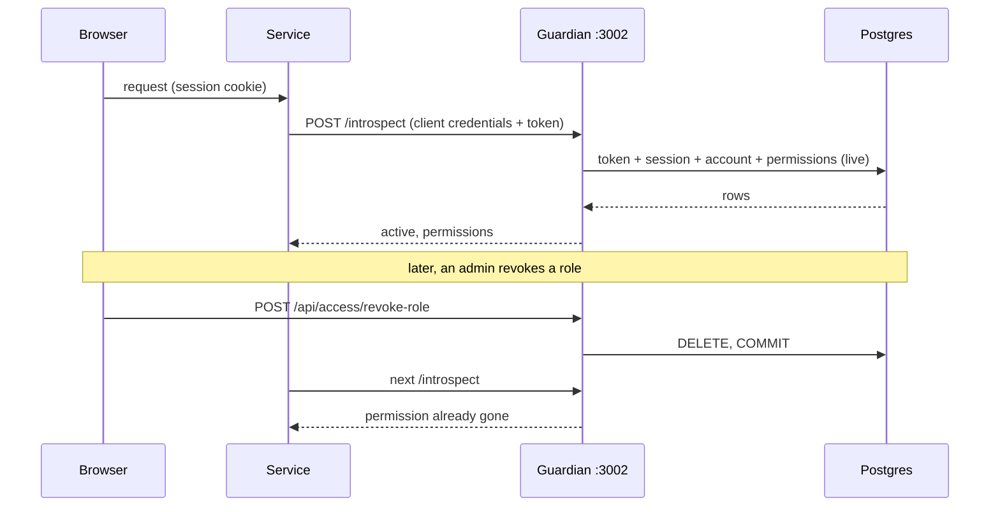
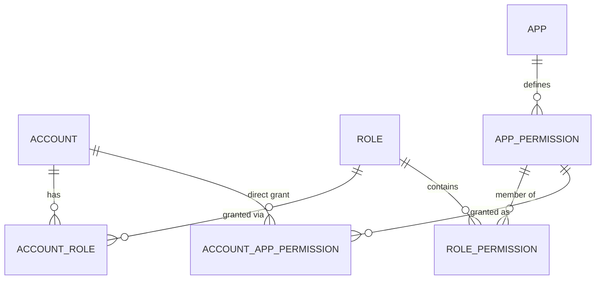

# Guardian architecture and design decisions

> **Partly outdated (2026-11-13).** The design moved to groups plus short-lived JWT access tokens, and `/introspect` is removed. See the decisions log at the top of `docs/ROADMAP.md`. Sections about opaque tokens, introspection, per-app permissions and immediate revocation describe the old design. They will be rewritten in milestone M2.

## Requirements that drive the design

1. Sign-up is open to everyone (rate limited).
2. Revoking or changing permissions, logging out and disabling accounts are effective **immediately**, for users and for apps.
3. Other services (mostly in the same Kubernetes cluster) must integrate with as little code as possible.
4. One Guardian deployment (frontend, backend, Postgres); metrics are scraped by Prometheus.

## Decisions

| Decision | Why |
|---|---|
| Access tokens are **opaque**, checked by `POST /introspect`; ID tokens stay JWTs | A self-contained JWT cannot be revoked, so permissions in it would be stale until expiry (violates 2). Services need no crypto or JWKS code (3). |
| Introspection answers from **live Postgres data** | One indexed query returns validity and the caller's permissions. Nothing between a commit and the next read (2). |
| **No Redis / no cache layer** | Any cache sits outside the transaction, so it has a window (and failure modes) where it is stale. Postgres reads are exact, cheap here, and one component fewer to run. See below. |
| Permissions resolved by the SQL view `account_effective_permission` | One definition of "who may do what" (roles, catchall roles, direct grants, expiry). Always current, usable by SQL tooling. |
| **Two listeners**: public `:3001`, internal `:3002` | Introspection, metrics and probes are never reachable through the ingress, even if an ingress rule is wrong (3, topology). |
| Rate limits in an UNLOGGED Postgres table | Correct across replicas without Redis; fine for login/sign-up volumes (1). |
| Client IP from `X-Forwarded-For` only with `TRUSTED_PROXY_HOPS` | Behind an ingress the TCP peer is the proxy; trusting the header blindly lets attackers dodge limits. |
| Origin check on `/api` + SameSite=Lax cookies + CSRF tokens on HTML forms | Simple CSRF defence for the admin/self-service API. |
| Max 4 concurrent argon2 hashes | Each hash needs 64 MiB; unbounded logins would OOM a memory-limited pod. |
| Graceful shutdown, `/healthz`, `/readyz`, DB pool limit | Rolling deployments without dropped requests; Postgres connections stay bounded. |

## Redis vs Postgres

| Option | Immediate? | Cost | Verdict |
|---|---|---|---|
| Redis cache with version stamps (previous design) | No: stale between commit and invalidation; stale up to the TTL if an invalidation is lost | New component to deploy, secure and monitor; ~350 lines | Rejected: conflicts with requirement 2 |
| In-process cache + `LISTEN/NOTIFY` | No: notification latency, lost messages while reconnecting | Reconnect and flush logic | Rejected |
| Materialized view | No: stale until refreshed; refresh recomputes everything | Refresh scheduling | Rejected |
| Trigger-maintained summary table | Yes (same transaction) | Triggers for catchall roles, fan-out and expiry | Not needed yet; the option if the view ever becomes a bottleneck |
| **Plain indexed queries + view** | **Yes** | None | **Chosen** |

Expected cost: token introspection is two indexed lookups (client authentication, token + permissions).
**Verify with the metrics**: `guardian_http_request_duration_seconds{route="/introspect"}`, `guardian_db_*`
pool gauges, `guardian_introspections_total`. Revisit only if p99 introspection latency or pool wait time
becomes a problem. Escalation order: PgBouncer, bigger Postgres, then a trigger-maintained table. Do **not**
use read replicas for these reads (replication lag breaks immediacy). Cache only non-security data if ever needed.

## Diagrams

### Topology



### Login (single sign-on)



### Authorizing a request and immediate revocation



### Permission model



`account_effective_permission` unions: catchall roles (all permissions of all apps), role permissions, and
direct grants, skipping expired ones. `/introspect` reads it filtered to the calling app.

## Kubernetes notes

```yaml
# Public: the ingress points here.            Internal: ClusterIP only, never in an Ingress.
apiVersion: v1
kind: Service
metadata: { name: guardian, namespace: guardian }
spec:
  selector: { app: guardian }
  ports: [{ name: http, port: 80, targetPort: 3001 }]
---
apiVersion: v1
kind: Service
metadata: { name: guardian-internal, namespace: guardian }
spec:
  selector: { app: guardian }
  ports: [{ name: internal, port: 3002, targetPort: 3002 }]
---
# Only labelled service pods and Prometheus may reach :3002
apiVersion: networking.k8s.io/v1
kind: NetworkPolicy
metadata: { name: guardian-ports, namespace: guardian }
spec:
  podSelector:
    matchLabels: { app: guardian }
  policyTypes: [Ingress]
  ingress:
    - ports: [{ port: 3001 }]
      from:
        - namespaceSelector:
            matchLabels:
              kubernetes.io/metadata.name: ingress-nginx
    - ports: [{ port: 3002 }]
      from:
        - namespaceSelector: {}
          podSelector:
            matchLabels: { guardian-client: "true" }
        - namespaceSelector:
            matchLabels:
              kubernetes.io/metadata.name: monitoring
```

Container settings: `readinessProbe` on `:3002/readyz`, `livenessProbe` on `:3002/healthz`, memory limit
of at least 512Mi (4 concurrent argon2 hashes at 64 MiB each plus the runtime), `TRUSTED_PROXY_HOPS=1`
behind a single ingress, and `DB_MAX_CONNS` x replicas below Postgres `max_connections`.
