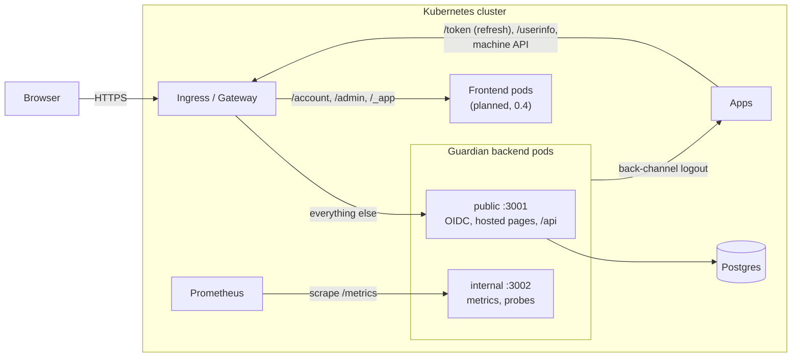
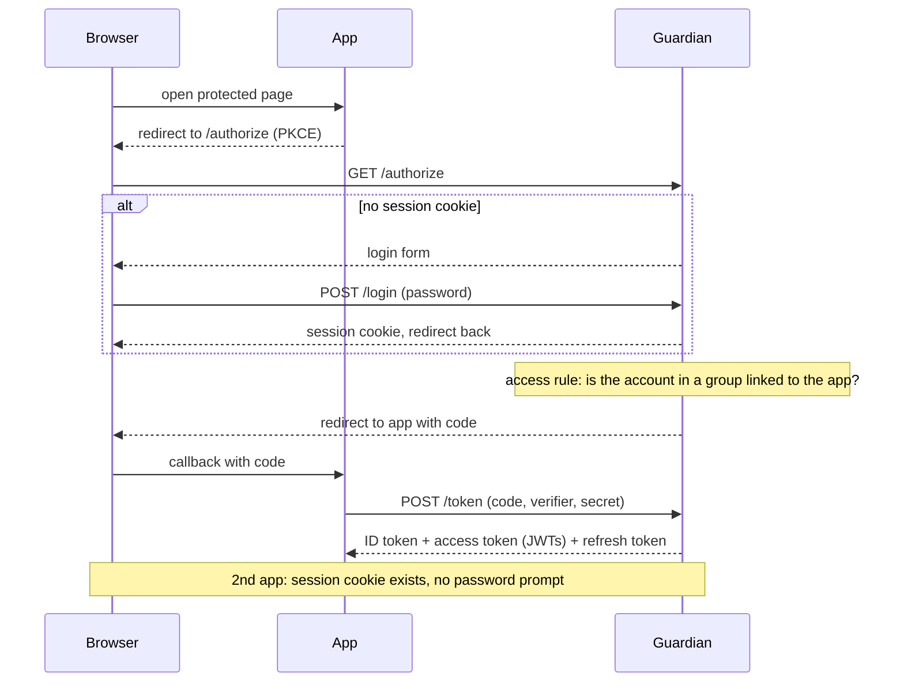
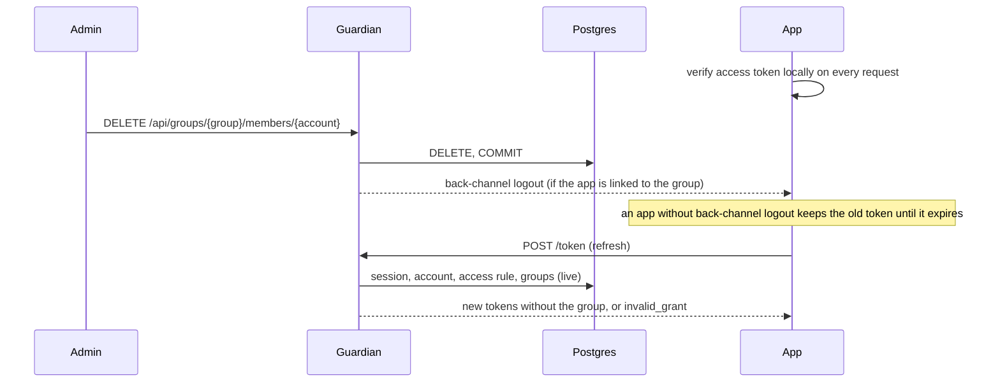
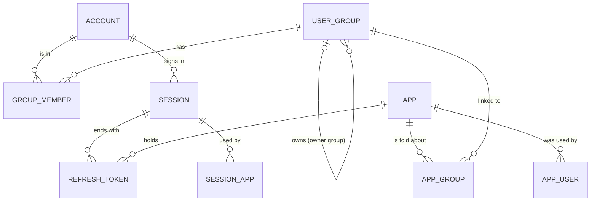

# Guardian architecture and design decisions

How Guardian is built and why. `docs/ROADMAP.md` (section 2) lists every design rule in detail;
`docs/INTEGRATION.md` is the guide for app developers.

## Requirements that drive the design

1. Sign-up is open to everyone (rate limited).
2. Group changes, logout and disabled accounts reach apps within a known, per-app window
   (`access_token_ttl_seconds`, at least 15 seconds), and at once for apps with back-channel logout.
3. Apps must not depend on Guardian for every request, so Guardian is not overloaded and a short Guardian
   outage does not take every app down.
4. Apps integrate with any standard OIDC library.
5. One Guardian deployment (frontend, backend, Postgres) that works with any number of replicas, in one or
   several clusters, against one shared Postgres. Prometheus scrapes its metrics.

## Decisions

| Decision | Why |
|---|---|
| **Groups**, not per-app permissions | Guardian knows who is in which group; each app decides what a group means. Groups are flat, membership can expire, and an app only ever sees the groups linked to it. Keeps Guardian simple and apps in charge of their own rules. |
| Access tokens are **short-lived signed JWTs** (`at+jwt`, RFC 9068) | Apps verify them locally (3, 4). They carry `sub`, `aud`, `scope`, `sid`, `amr` and `groups`, but no profile data, and are not stored. |
| **Every refresh re-checks live data** | Session, account, the app's access rule and groups are read from Postgres at each refresh, in one place (`issueTokens`). That is what bounds staleness to the token lifetime (2). |
| **Stable refresh tokens** for apps with a secret | One per sign-in, never replaced, valid while the session lives. Parallel refreshes and retries cannot trip a reuse detector; a stolen token is useless without the client secret. Apps without a secret get none until rotation is added for mobile apps. |
| **Back-channel logout** on logout, account deletion and leaving a group | Makes those changes immediate for apps that support it (2). Delivery is best effort; the next refresh is the safety net. |
| The **access rule** is enforced by Guardian | With `groups`, accounts outside the app's linked groups never get a code or a token, at sign-in or at refresh. Apps do not have to remember to refuse them. |
| **No Redis, no cache** | Each refresh is a handful of indexed queries. Load scales with signed-in users times apps divided by the token lifetime, not with request rate. One component fewer to run and keep consistent. |
| **Two listeners**: public `:3001`, internal `:3002` | Metrics and probes are never reachable through the ingress, even if an ingress rule is wrong. |
| Rate limits in an UNLOGGED Postgres table | Correct across replicas without Redis; fine for login and sign-up volumes (1). |
| Client IP from `X-Forwarded-For` only with `TRUSTED_PROXY_HOPS` | Behind an ingress the TCP peer is the proxy; trusting the header blindly lets attackers dodge limits. |
| Origin check on `/api`, SameSite=Lax cookies, CSRF tokens on HTML forms | CSRF defence for the browser API and hosted pages. |
| The machine API uses Bearer tokens with Guardian as audience | An app reads its own groups and users without a user present. A user's access token (audience: the app) is never accepted there. |
| At most 4 concurrent argon2 hashes | Each hash needs 64 MiB; unbounded logins would exhaust a memory-limited pod. |
| Migrations with goose, embedded in the binary | One image, no SQL files beside it; a Postgres lock makes replicas take turns. |
| Graceful shutdown, `/healthz`, `/readyz`, bounded DB pool | Rolling deployments without dropped requests; Postgres connections stay bounded. |

## Load and when to worry

The steady load is refreshes: about `signed-in users × apps ÷ token lifetime` per second. 10,000 signed-in
users with one app each on the default 300 seconds is about 33 refreshes per second. Each refresh is a few
indexed reads and one RS256 signature.

Watch `guardian_http_request_duration_seconds{route="/token"}`, `guardian_token_requests_total` and the
`guardian_db_*` pool gauges. If they become a problem, in this order: longer token lifetimes for apps that do
not need short ones, PgBouncer, a bigger Postgres. Do not read from replicas for refreshes: replication lag
would let revoked access through.

## Diagrams

### Topology

Apps validate access tokens themselves against Guardian's public keys (`/jwks.json`), so they only call
Guardian to sign users in, to refresh, and optionally for userinfo or the machine API.

### Sign-in (single sign-on)

### A group change reaching an app

### Data model (main tables)

## Kubernetes notes

The Helm chart (release 0.2) creates these. The shape matters more than the details:

- The ingress or Gateway points only at port 3001. Port 3002 is exposed by a separate ClusterIP Service.
- A NetworkPolicy lets only the ingress controller reach 3001 (its namespace is a chart value) and only
  Prometheus and the kubelet reach 3002.
- Every replica is the same; nothing is stored per pod or per cluster.
