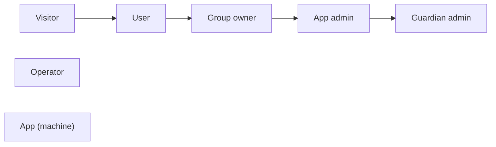

# Guardian's users and what they need

Who uses Guardian, and what each of them must be able to see and do, up to 1.0. Every requirement has an id
(V3, U12, A18, ...) that stays the same when the list changes, so designs, pages and issues can refer to it.
`docs/PAGES.md` maps the ids to pages. `docs/ROADMAP.md` is the plan these come from.

## Where people work

| Surface | Who | What |
|---|---|---|
| **Sign-in pages** | Everyone | Pages Guardian's backend serves: sign in, sign up, consent, sign out, password reset, two-factor. Server-rendered, they work without JavaScript (except the security-key prompt). |
| **Management UI** | Signed-in users, group owners, admins | The web interface for everything else: the **account area** (`/account`) for one's own account, and the **admin area** (`/admin`). A separate frontend (SvelteKit) on the same hostname, using Guardian's session cookie. (The roadmap used to call this the "console".) |
| **CLI** | Operators | `guardian <command>` in the Guardian pod, through `kubectl exec`. Only for operations on the deployment itself; never needed for everyday administration. |
| **API** | The management UI, scripts, apps | `/api/v1` (`docs/openapi.yaml`). Everything the management UI does goes through it. |

## Release tags

Each requirement says when it works through the **API** (or backend) and when it appears in the **web**
interface: `0.1 / 0.4` means the API has it from 0.1 and the management UI from 0.4. For sign-in pages the two
are the same release. **Status** is where it stands today: done, API done, planned, or proposed (an idea
that is not yet part of the plan).

## Roles and what they inherit

An arrow means "has every requirement of the role before it, plus its own". It describes requirements, not
membership: a group owner is not an app admin, but an app admin needs everything a group owner needs.

| Role | Who | Inherits | Since |
|---|---|---|---|
| **Visitor** | Anyone who is not signed in | — | 0.1 |
| **User** | Anyone with an account who is signed in | Visitor (a user was a visitor until signing in) | 0.1 |
| **Group owner** | A member of a group that is set as another group's owner group. Their rights cover only the groups they own | User | 0.1 |
| **App admin** | A member of an app's owner group: manages that app, and links to it only groups they own | Group owner (for the groups they own) | 1.0 |
| **Guardian admin** | A member of the built-in `guardian-admins` group | App admin for every app, and so Group owner for every group | 0.1 |
| **Operator** | Someone with access to the Kubernetes cluster. Not a Guardian role: usually also a Guardian admin, but neither implies the other | — | 0.1 |
| **App (machine)** | An app calling Guardian with its own credentials, no person involved | — | 0.1 |

Guardian admins can do everything marked **App admin** below, for every app. An app admin sees the admin
area with only Apps in it, and only their own apps there; the pages leave out what only a Guardian admin may
do (deleting the app, choosing its admins, the machine API).

## Showing personal data

Personal data appears only where someone deliberately went to see it, never on a page they reach while
doing something else. Someone working while another person looks over their shoulder must not expose
personal details by accident.

- The admin area opens on an overview of counts only (A28). Lists of accounts, members or audit entries
  appear only on pages an admin opens on purpose; those may show their data straight away.
- Home (`/`), where a signed-in user lands, shows no personal details (U19): only their apps (U20), actions
  needed and the way to the account and admin areas. The account area opens on the profile page, where
  the email address is masked until the user chooses to show it (U7). The
  sessions page masks IP addresses the same way (U12).
- An admin's page about one account (AD2) also masks the email until shown, because admins often open it to
  do something else, such as disabling the account.

## Visitor

| Id | Requirement | API / web | Status |
|---|---|---|---|
| V1 | Sign in with username or email and password. | 0.1 | done |
| V2 | Clear messages for wrong credentials and too many attempts, never revealing whether an account exists. | 0.1 | done |
| V3 | Create an account: username and password; email optional, or required when the operator sets `REQUIRE_EMAIL`, and confirmed by a link. The password is typed twice. After sign-up the user is signed in and continues to the app they came from; when they gave an email, only once it is confirmed. The sign-up page shows three notices: without an email only an admin can reset a forgotten password; Guardian is a hobby project under development; use a unique password. | 0.1 (email 0.3) | done |
| V4 | Understand what went wrong when an app sends a broken sign-in request, an expired form, or a page that does not exist. | 0.1 | done |
| V5 | Forgot password: ask for a reset link (the answer is the same whether or not the account exists), then set a new password from the link. Two-factor still applies afterwards. | 0.3 | done |
| V6 | See the result of an email confirmation link: confirmed, expired, or the address is now used by another account. | 0.3 | done |
| V7 | Pass the second factor at sign-in: an authenticator code or a recovery code (0.3), or a security key (0.5). | 0.3, keys 0.5 | done |
| V8 | Sign in with a passkey, without a password. | 0.5 | done |
| V9 | Sign-up and forgot-password, and sign-in after several failures from the same address, ask the browser to solve a short proof-of-work puzzle, so bots pay for every attempt. A browser without JavaScript is told why the form needs it; signing in works without it until an address fails repeatedly. | 1.0 | done |

## User

Everything a visitor has, plus:

**While signing in to an app**

| Id | Requirement | API / web | Status |
|---|---|---|---|
| U1 | Consent: which app asks, as whom the user is signed in, and what the app will get. Allow or deny. | 0.1 | done |
| U2 | Be told plainly that their account has no access to an app, and what to do about it. | 0.1 | done |
| U3 | Choose a new password after an admin set a temporary one, before going on. | 0.1 | done |
| U4 | Set up two-factor when it is required (they are an admin or a group owner, or the app requires it), including saving recovery codes and confirming one before setup finishes. | 0.3, keys 0.5 | done |
| U5 | Confirm signing out when an app asks for it without proof it is them, and see that they are signed out of Guardian and all apps. | 0.1 | done |
| U6 | When already signed in: see as whom, go to their account, or sign out to switch account. | 0.1 | done |

**In the account area**

| Id | Requirement | API / web | Status |
|---|---|---|---|
| U7 | View and change their profile: display, given and family name, picture, locale, time zone. The email address is shown masked (for example `a•••@example.com`) until the user chooses to show it. | 0.1 / 0.4 | done |
| U8 | Change their username. | 0.1 / 0.4 | done |
| U9 | Add, change or remove their email; a new address shows as waiting for confirmation until its link is used, and the old address is told. | 0.3 / 0.4 | done |
| U10 | Change their password with the current one; their other sessions end. | 0.1 / 0.4 | done (the current password is replaced by "Confirm it's you", U16) |
| U11 | Manage two-factor: authenticator app on or off, new recovery codes (0.3); security keys and passkeys, listed, renamed and removed (0.5). Warned before removing their last way to recover the account. | 0.3, keys 0.5 / 0.4, keys 0.5 | done |
| U12 | See their sessions (device or browser, IP address partly masked until shown, when signed in, last active, which is this one); sign out one or all. | 0.4 / 0.4 | done |
| U13 | See the apps they use and what each can see; remove an app's access. | 0.4 / 0.4 | done |
| U14 | Download their data as JSON. | 0.3 / 0.4 | done |
| U15 | Delete their account, with the 30-day grace period explained. Refused for the last administrator. | 0.3 / 0.4 | done |
| U16 | Confirm it is them (password or second factor) before a protected change: username, email, password, two-factor, recovery codes, sessions, connected apps, deletion. The change is then saved without starting over. | 0.3 / 0.4 | done |
| U17 | Receive security emails when they have an address: password changed, two-factor added or removed, email being changed (to the old address), two-factor reset by an admin (with the reason). | 0.3 | done |
| U18 | See the groups they are in, by display name (never by key), with expiry dates. Hidden groups (A26) are left out. | 0.1 / 0.4 | done |
| U19 | A home page (`/`) without personal details: no email, sessions or other data, only their apps (U20), the way to the account area (and the admin area for admins) and any action needed (for example "set up two-factor" or "confirm your new email address", without showing the address). | 0.1 (simple) / 0.4 | done |
| U20 | See the apps they can use, each opening the app's homepage: the apps they are connected to (have signed in to), and the apps available to them that they have not used yet. Apps without a homepage, or that they may not sign in to, are left out. | 0.1 / 0.4 | done |

## Group owner

Everything a user has, plus, for each group they own:

| Id | Requirement | API / web | Status |
|---|---|---|---|
| O1 | List the groups they own. | 0.1 / 0.4 | done |
| O2 | See each group's active members and when their memberships expire. | 0.1 / 0.4 | done |
| O3 | Add a member by typing their exact username or email, optionally with an expiry, and remove members. There are no suggestions or partial matches, so nothing leaks: the answer is only "No user found" or "User added". | 0.1 / 0.4 | done |
| O4 | Two-factor is required for them. | 0.3 | done |
| O5 | See which apps their groups are linked to (names only; linking stays with admins). | 0.1 / 0.4 | done |

## App admin

Everything a group owner has, plus, for each app they administer: the members of the app's owner group,
which Guardian admins choose (A32). Guardian admins can do all of these for every app.

| Id | Requirement | API / web | Status |
|---|---|---|---|
| A15 | List apps: Guardian admins see all, app admins their own. | 0.1 / 0.4 | done |
| A17 | Change the app's settings: names, logo, URLs, redirect URIs, back-channel logout URI, skipping consent, token lifetime, scopes. | 0.1 / 0.4 | done |
| A18 | Set the access rule and the linked groups (app admins: only groups they own). Turning machine API access on or off is for Guardian admins only, because it widens what the app can read about users. | 0.1 / 0.4 | done |
| A19 | Rotate the client secret, with a grace period for the old one. | 0.1 / 0.4 | done |
| A20 | Disable and re-enable the app. | 0.1 / 0.4 | done |
| A21 | Copy what is needed to configure the app: discovery URL, client id, redirect URIs. | 0.4 | done |
| A22 | Read the audit log: Guardian admins all of it, app admins the entries about their app (without IP addresses). | 0.1 / 0.4 | done |
| A24 | Two-factor is required for them. | 0.3 | done |

## Guardian admin

Everything an app admin has for every app, and everything a group owner has for every group, plus:

**Accounts**

| Id | Requirement | API / web | Status |
|---|---|---|---|
| A1 | List and search accounts, filter by status. | 0.1 / 0.4 | done |
| A2 | View an account: profile, status, groups, last sign-in. | 0.1 / 0.4 | done |
| A3 | Create an account; an email set by an admin counts as confirmed. The user must choose their own password at the first sign-in (U3). | 0.1 / 0.4 | done |
| A4 | Change an account's profile, username and email. | 0.1 / 0.4 | done |
| A5 | Disable and re-enable an account; disabling signs it out everywhere. Refused for the last administrator. | 0.1 / 0.4 | done |
| A6 | Set a temporary password, typed twice, which signs the account out everywhere and must be changed at the next sign-in (U3). From 0.5 Guardian can also generate one and copy it to the clipboard. | 0.1 / 0.4 | done |
| A7 | Delete an account: disabled at once, erased after the grace period (0.3), or erased at once ("erase now", 0.3). | 0.1, grace and erase 0.3 / 0.4 | done |
| A8 | Restore a deleted account during its grace period. | 0.3 / 0.4 | done |
| A9 | Reset an account's two-factor, giving a reason; the user is emailed. | 0.3 / 0.4 | done |
| A10 | Sign an account out everywhere without disabling it. Admins do not see the account's sessions. | 0.1 / 0.4 | done |

**Groups**

| Id | Requirement | API / web | Status |
|---|---|---|---|
| A11 | List all groups. | 0.1 / 0.4 | done |
| A12 | Create, change and delete groups; the key is chosen at creation and never changes, which the form must make clear. Built-in groups cannot be changed. | 0.1 / 0.4 | done |
| A13 | Manage the members of any group, with expiry dates; also from an account's page. | 0.1 / 0.4 | done |
| A14 | Set or remove a group's owner group. | 0.1 / 0.4 | done |
| A26 | Mark a group as hidden from its members: it is left out of their own group list (U18). Owners and admins still see it, and apps still receive it in tokens, which a user's browser can sometimes read, so this hides it from the account area, not from a determined user. | 1.x, if needed | deferred |
| A27 | Make a group a single-app group, bound to one named app, so a group made for one app can never be reused to grant access elsewhere, not even by moving it. The new-group form asks "Is this group for one app only?" with neither answer preselected; choosing yes means choosing the app. An existing group can be bound if it is linked to that app only. A binding is permanent: it cannot be removed or moved (create a more general group instead), and linking the group to any other app is refused. When the bound app is deleted the group stays, bound to no app, so it can never be linked again and its memberships and audit history stay intact; such groups are deleted automatically once the audit retention period has passed since the app was deleted (0.5, with audit retention). Built-in groups cannot be bound. | 0.1 / 0.4, clean-up 0.5 | done |
| A29 | Copy a group: a new group, with a new key, starting with the same members (and their expiry dates), after which the two are unrelated. For replacing an app without adding every member again, for two groups that start alike but will grow apart, and for starting a larger group from a smaller one. | 1.0 / 1.0 | done |

**Apps**

| Id | Requirement | API / web | Status |
|---|---|---|---|
| A16 | Register an app; a confidential app's secret is shown once. | 0.1 / 0.4 | done |
| A25 | Delete an app, with its secrets, tokens and consents. | 0.1 / 0.4 | done |
| A30 | Choose how an app's tokens are signed: RS256 (the default, which every OIDC app handles) or ES256 (smaller and faster, for apps that support it). Each algorithm has its own key and rotation, and a change applies at the app's next sign-in or refresh. | 1.0 / 1.0 | done |
| A31 | An app can ask for two-factor for a single sign-in (`acr_values=mfa`), for example before a sensitive action; the tokens say whether the sign-in met it (`acr`). | 1.0 / — | done |
| A32 | Choose an app's admins: an owner group whose members manage the app (A15 to A22), or none. | 1.0 / 1.0 | done |

**Oversight**

| Id | Requirement | API / web | Status |
|---|---|---|---|
| A23 | A warning across the admin area while there is only one administrator. | 0.4 | done |
| A28 | An overview as the admin area's start page, with aggregated figures only and nothing that identifies a person: numbers of accounts by status, groups and apps, sign-ins and failed sign-ins over the last day, rate-limit hits, number of administrators (and, from 0.3, how many have two-factor), accounts waiting for erasure. Audit entries are not shown there, because they name accounts and IP addresses. | 0.4 / 0.4 | done |

## Operator

Works in the CLI and with Kubernetes, never in the management UI. Has no requirements on Guardian's pages.

| Id | Requirement | Release | Status |
|---|---|---|---|
| P1 | Run database migrations (`guardian migrate`, or at startup). | 0.1 | done |
| P2 | Back up, verify, restore, and export the deletion log. | 0.2 | done |
| P3 | Rotate or emergency-revoke signing keys; add and promote encryption keys. | 0.3 | done |
| P4 | Reset two-factor for everyone (dry run by default, confirmation required). | 0.3 | done |
| P5 | Set the first admin password through a Secret. | 0.1 | done |
| P6 | Metrics for Prometheus, and health and readiness probes. | 0.1 | done |
| P7 | Recover a locked-out sole admin with the documented SQL in the runbook. | 0.2 | done |

## App (machine)

| Id | Requirement | Release | Status |
|---|---|---|---|
| M1 | Sign users in through OIDC and receive their groups (only those linked to the app). | 0.1 | done |
| M2 | Read its own linked groups, their members and its users through the machine API, with its own credentials. | 0.1 | done |

## Change log

- 2026-11-15: first version, from `docs/ROADMAP.md` and the owner's answers: the admin area stays on the web
  (with the CLI only for cluster operations); app admins stay in 1.x but are documented now; users see their
  groups (U18); owners see linked apps (O5); admins can sign an account out everywhere but not see its
  sessions (A10); owners add members by exact username or email with no suggestions (O3). A20 was split:
  deleting an app is now A25. Hidden groups (A26) and single-app groups (A27) are proposals.
- 2026-11-15: the role graph is a single chain. Hidden groups (A26) are deferred to 1.x, if a need arises.
  Added the admin overview (A28) and the rule that landing pages show no personal data.
- 2026-11-15: single-app groups (A27) decided: bound permanently to one named app, asked on the new-group
  form with no preselected answer, kept unbound after their app is deleted and cleaned up after audit
  retention; backend in 0.1. Added copying groups (A29, 1.x), the account area start page (U19) and the
  masked email on the profile.
- 2026-11-15: passwords are typed twice wherever one is chosen or set; sign-up signs the user in (after
  email confirmation when an email is given); session IPs shown masked; admin-created accounts must change
  their password; temporary passwords typed by the admin, generated from 0.5; users see group display names only.
- 2026-11-19: the account area start page became Home (`/`, U19), with the apps a user can use (U20):
  connected apps and available apps. The account area now opens on the profile.
- 2026-11-21: every requirement that is done is named by at least one test (`Covers:` in the test, checked by `backend/requirements_test.go`). U4, U17, P3 and P4 were done already and are marked so; P7 is done with the runbook in `docs/INSTALL.md`, whose SQL a test runs as printed.
